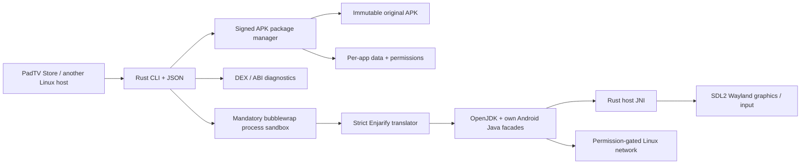

# Architecture and milestones

`crates/core` separates APK parsing, DEX inspection, atomic installation,
process supervision, sandbox construction and media capability reporting.
`crates/native` implements the host JNI and scene renderer. `framework` contains
Android-facing Java classes. `runtime/translate.py` calls the existing Enjarify
library with **allowErrors=False**; a failed class cannot silently become a
partially usable application. The source APK is never rewritten. A derived JAR
cache and checksum live beside it. APK and cache are checked on each launch.

## ADR 001: initial execution backend

ART is a future backend, not this release's runtime. Studied standalone ART
ports require substantial AOSP/libcore/Bionic and native-linker work before
they run reliably on glibc Linux. A reduced backend makes real installation,
DEX arithmetic, Android Activity and API→Linux calls testable now. Debian's
Enjarify and OpenJDK avoid inventing a DEX interpreter. Limitations include DEX
035 only, incomplete metadata/annotation fidelity, Android versus Java class
library differences and unimplemented Android services. Kotlin is not
claimed compatible just because it produces DEX. ART integration must preserve
the package store, JSON interface, sandbox and host service boundaries.

## Progression (PadBridge versions, not PadTV versions)

| Milestone | Current implementation / release gate |
|---|---|
| 0.1 APK loader / manager | Signed base APK, metadata, raster icon, version and signer checks, atomic selection, remove/data choice. Splits and key rotation pending. |
| 0.2 DEX execution | Experimental DEX035/JVM backend; full ART/libcore compatibility pending. |
| 0.3 framework/services | Activity lifecycle, assets, private storage; multi-Activity, Binder and service broker pending. |
| 0.4 graphics | Experimental SDL2 software Wayland TextView/Button/ImageView; layouts/resources/EGL/Vulkan pending. |
| 0.5 TV input | Keyboard D-pad/select and mouse; AndroidX Leanback, CEC and physical controllers pending. |
| 0.6 JNI/native | Host Java→Rust JNI works; app-provided Bionic `.so` loading is rejected. |
| 0.7 audio/video | Explicit unsupported diagnostics; PipeWire/FFmpeg/VA-API adapters pending. |
| 0.8 ARM64 | Planned, no binary translation shipped. |
| 0.9 Store | Local APK import, launch, permissions and removal UI; full catalog delivery and broader compatibility pending. |
| 1.0 stable | Not reached; requires supported real apps, adversarial sandbox testing and hardware validation. |

Later API adapters should use narrow host brokers, not expose unrestricted
system D-Bus to APKs: Bluetooth→BlueZ, Wi-Fi→NetworkManager,
PowerManager→PadTV System API. Binder needs a separate transaction/identity
layer. Graphics needs Surface/EGL and synchronization before protected video.
Native ABI support requires a reviewed Bionic/linker bridge before ARM64
translation. MediaCodec then maps to capability-tested FFmpeg/VA-API/Vulkan
Video; AudioTrack to PipeWire. None of these planned adapters returns fake
success today.
